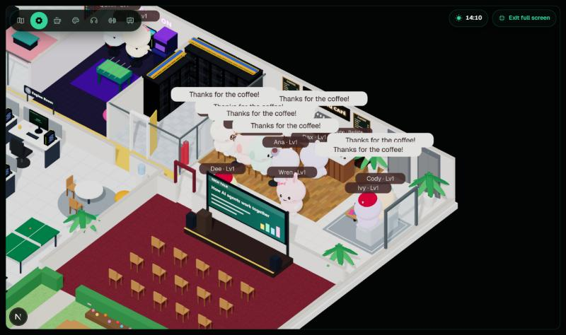
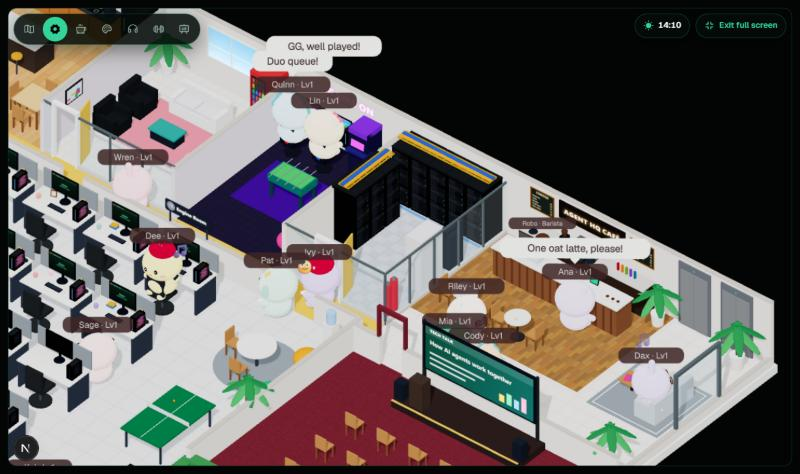
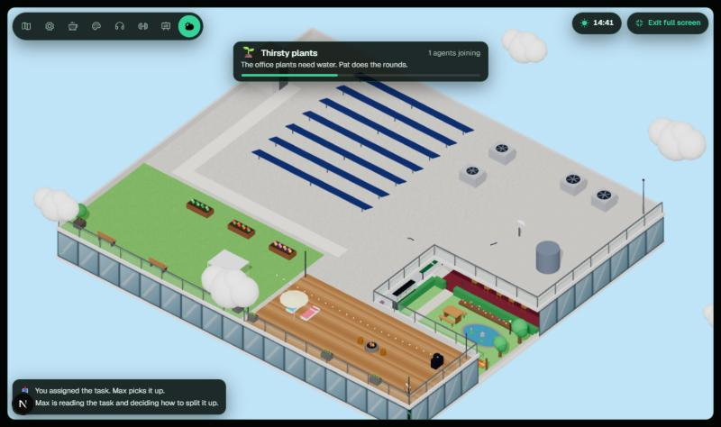
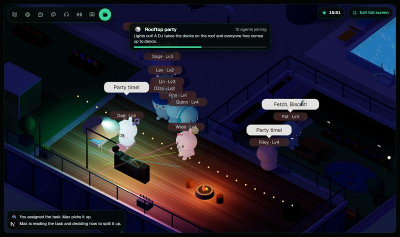
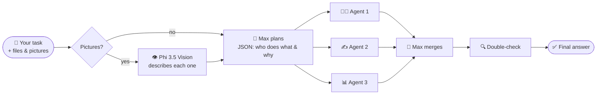

<div align="center">


# 🏢 AI Agent Office

**Hand any job to a team of AI agents and watch them work it out in a cosy 3D office, running entirely in your browser.**

[](https://ai-agent-office-one.vercel.app)


[Highlights](#-highlights) · [Screenshots](#-screenshots) · [The office](#%EF%B8%8F-the-office) · [The team](#-the-team) · [How it works](#-how-it-works) · [Run locally](#-run-locally)

</div>

---

## ✨ Highlights

| | |
|---|---|
| 🔒 **Private and free** | Qwen 3.5 runs on your graphics card through WebGPU. No API key, no server, and nothing you type leaves your device. |
| 🧑‍💼 **A real team** | Max the manager splits each task, picks the right agent for each part and explains why, then merges the results and double-checks the answer. |
| 🧠 **Think mode** | Agents write reasoning notes before answering, streamed live onto their desk PCs. |
| 🎓 **Learn and test yourself** | Switch the task box to **Learn** and Theo the tutor teaches any topic (or your homework) step by step, or to **Test me** for a multiple-choice quiz on a topic, your notes, a past exam paper (PDF) or a timed exam-prep preset (สอบเข้า ม.4, สอวน., IJSO), with the answer key cross-checked by Quinn. Answer it in the app, get your score with explanations, retry what you missed, or have Theo teach it. |
| 📎 **Files and pictures** | Attach text files and pictures (drop, paste or browse). A vision model describes each picture for the team. |
| 🏙️ **A living office** | 20 animal agents (and Biscuit the office dog) work, take breaks, queue for coffee, game together, greet each other in the halls, meditate and hold strategy meetings across six working zones. |
| 🌤️ **Rooftop** | A second level: switch the view to the roof, where agents ride the elevator up for fresh air, a sky deck, a fire pit and a roof garden. |
| 🏙️ **A tower in the city** | The office is the top floor of a high-rise: from the roof you see 18 storeys of glass drop to a street with traffic, every floor full of people at their workstations, the office logo across the top, and a skyline of towers whose windows light up at night. |
| 🌙 **Day and night shifts** | A day crew (7:00-19:00) and a night crew (19:00-7:00) with their own night-shift wing. Agents clock in and out by the lift, and everyone on shift gets together for breakfast, lunch and dinner. |
| 💬 **Small talk** | Agents sharing a table hold real back-and-forth conversations, taking turns line by line (sometimes about the task the team is working on). |
| ☕ **Tap for coffee** | Click the café counter (or Robo the barista) to buy the whole team a round. |
| 🎥 **Follow cam** | Click any agent, or Max, and the camera follows them around the office. |
| 🌏 **English and ไทย** | The whole app, the 3D speech bubbles and the AI answers switch language. |
| 🎨 **Make it yours** | 6 themes (Liquid chrome by default), floors, desks, decorations, your office name in neon, break rules and time of day. |

## 📸 Screenshots

<table>
  <tr>
    <td width="50%"><br /><sub><b>Strategy meeting</b>: free agents gather in the hub to plan the quarter.</sub></td>
    <td width="50%"><br /><sub><b>Creative Labs</b>: whiteboards, a touch table, pinball and arcade.</sub></td>
  </tr>
  <tr>
    <td width="50%"><br /><sub><b>Fitness & Meditation</b> and <b>Deep Focus Pods</b>.</sub></td>
    <td width="50%"><br /><sub><b>Follow cam</b>: click an agent to follow them and see what they're up to.</sub></td>
  </tr>
  <tr>
    <td width="50%"><br /><sub><b>Coffee round</b>: tap the counter and the team heads to the café.</sub></td>
    <td width="50%"><br /><sub><b>Gaming rigs and server room</b>: duo queue on custom RGB PCs.</sub></td>
  </tr>
  <tr>
    <td width="50%"><br /><sub><b>Rooftop</b>: sky deck, pool, roof garden and solar panels.</sub></td>
    <td width="50%"><br /><sub><b>Rooftop party</b>: a rare night event with a DJ, lasers and a disco ball.</sub></td>
  </tr>
  <tr>
    <td colspan="2" align="center"><br /><sub><b>New task</b>: attach pictures and files, and choose Fast or Think.</sub></td>
  </tr>
</table>

## 🗺️ The office

Six working zones, each with a name board. The toolbar on the 3D view flies the camera to any of them.

| | Zone | What's there |
|---|---|---|
| ⚙️ | **Engine Room** | The open-plan hall of 24 hot-desks. Every PC shows its agent's live output like a terminal. |
| ☕ | **Social & Wellness Core** | Open kitchen, café espresso bar and snacks, bistro tables, the wellness corner and nap chairs. |
| 🎨 | **Creative Labs** | Two digital whiteboards, a touch-screen table, a 3D printer, pinball, an arcade cabinet and a beanbag for big thoughts. |
| 🎧 | **Deep Focus Pods** | Four sound-proofed glass booths with felt walls, a desk each and red/green busy lights. |
| 🧘 | **Fitness & Meditation** | Treadmills, an exercise bike and dumbbells on a rubber floor; yoga mats with a mirror wall; a tatami corner with cushions and candles. |
| 📊 | **Strategy Hub** | A formal conference room: table for ten, walnut wall, video-call screen, speakers and a pendant light. |

Beyond the zones there's a meeting room with a live projector, a lounge, a **game room** with two custom gaming rigs, a **server room**, a **lobby café**, a **town hall** and a **garden** with a koi pond, picnic table, loungers and a hammock.

| | Room | What's there |
|---|---|---|
| ☕ | **Lobby café** | Counter with a pastry case, back bar with an espresso machine, grinder and syrups, chalkboard menus, café tables and a sofa lounge. **Robo the barista** shuttles between the machine, the till and the pickup. Agents queue, order, collect their cup and sit down, or take it back to their desk. **Click the counter or Robo** for a coffee round. |
| 🌙 | **Night-shift wing** | East of the garden: 12 desks of its own on a dark-blue carpet, a neon NIGHT SHIFT sign, a kitchenette with a steaming coffee machine, palms and a floor lamp; a door to the garden and glass to the strategy hub. The night crew works here while the day crew is home. |
| 🖥️ | **Server room** | Two rows of 42U racks with server faces and blinking status LEDs (red during a server alarm), a perforated raised floor with a cold aisle, yellow ladder cable trays, a precision cooling unit, a UPS cabinet and fire-suppression cylinders. |
| 🎮 | **Game room** | Two high-end custom gaming PCs (glass-sided RGB towers, wide screens where the level scrolls while someone plays, RGB keyboards, racing chairs), an arcade cabinet and foosball. |
| 🌤️ | **Rooftop** (second level) | The **Rooftop** button on the 3D view lifts the camera to the roof: blue sky (orange at sunset, deep blue at night), drifting clouds and birds. A **sky deck** with glass railings to lean on, a fire pit (lit after dark), sun loungers, an umbrella, a BBQ, a telescope and string lights; a raised **rooftop pool** with steps and poolside loungers (agents swim laps, half under the rippling water); a **kite** that someone flies from the roof garden; a **roof garden** with raised beds, a greenhouse and benches; **solar panels**, HVAC units with spinning fans, a water tank, a satellite dish and an antenna with a blinking warning light. The garden courtyard is left open, so you can look down at the koi pond and watch whoever is down there (a picnic, someone playing fetch with Biscuit) from the roof. Agents **take the elevator** up and down (they step in, ride, and walk out on the other floor), go up most around lunch and sunset, and the camera follows a selected agent between floors. The office sits at the top of an **18-storey glass tower** with the **office logo** (the AI badge and your neon sign's name) near the top and over the lobby: the roof view shows its curtain walls dropping to the street, with **office floors behind every window** (rows of workstations with glowing monitors and people at work, meetings round a table, a sofa corner; lights on and screens glowing after dark), cars driving round the block, a lobby canopy and street trees, and a city of towers around it (lights on in their windows at night, red beacons blinking on the tallest). The night wing's roof has a **helipad** with edge lights and a windsock. |
| 💻 | **Every desk** | A custom PC tower with a tempered-glass side, RGB fans and a front light strip that cycle through colours. |

### Life in the office

- **Two shifts**: the day crew works 7:00-19:00 at the main desks, the night crew 19:00-7:00 in the night-shift wing (support, security, QA, data and translation by default; switch anyone in their panel). At the end of a shift agents finish what they're doing, say goodbye and take the lift home; the next crew steps out of the lift with a "Morning, team!" or "Evening, night crew!". Only the crew on shift takes on tasks.
- **Mealtimes**: breakfast at 7:30 (pancakes and coffee), lunch at 12:00 and dinner at 19:30. Everyone on shift and free sits down together in the kitchen, the cafés, the garden or by the rooftop fire pit, with plates on the tables.
- **Conversations**: at café tables, the picnic table, the breakout table, the touch table and the fire pit, two agents talk in turns ("Did you see the new task?" "About the launch plan?" "Yes! Tricky one."). A dozen conversations in English and Thai.
- **Breaks follow the clock**: coffee in the morning, a lunch rush at noon, games after five. Each agent spends most breaks in their favourite zone.
- **Work happens in the zones too.** When Max hands an agent a job, agents whose favourite zone has a workplace often take it there: researchers and writers to a focus pod, analysts, planners and strategists to the strategy-hub table, designers and innovators to the touch table or whiteboards, marketers and translators to a café table. They read up while their part waits its turn, work there while it streams, then wind down and wander off.
- **The rooms react to people**: a pod's busy light turns red and its screen wakes up with scrolling work when someone's inside; whiteboards fill with a fresh sketch, left to right, while someone draws; the touch table glows and projects floating ideas; the 3D printer's head sweeps as the print grows; the hub's screen goes live (with a blinking REC dot) when people meet; the pinball playfield flashes while someone plays.
- **More to do**: a music corner in the creative labs (an upright piano and a guitar), a painting easel that fills with a sunset while someone paints, and **Biscuit the office dog**, who sits by colleagues for a pat ("Who's a good boy?"), naps by his kennel, drinks from his bowl in the kitchen and plays fetch in the garden.
- **Little routines**: agents queue at the café, order from Robo, collect a cup and carry it around; stop to say hello when they pass a colleague; and stretch, sip from a mug, read or check their phone at their desk between jobs.
- **Two-person activities need two people.** Ping-pong, foosball, the touch-table brainstorm and café chats start with an invitation: the agent asks the nearest free colleague, both hurry over and play the same game. If nobody's free they pick something else, and if a partner gets called away the other wraps up.
- **Max makes his rounds.** Between tasks he checks on the desks, reviews the roadmap in the hub, rehearses on the town-hall stage, visits the labs, grabs a coffee and says hi to Robo. He hurries back to the projector when work arrives.
- **22 office events** plus three daily meals, timed to the hour: the rare **rooftop party** (lights out everywhere, a DJ at the decks, lasers, a spinning disco ball, colour-changing party lights and a strobe, everyone free dancing on the roof; the view flies up to watch), rooftop hangout, coffee round, strategy meeting, hackathon, all-hands, garden picnic, pizza party, fire drill, birthday, yoga class, karaoke, movie night, ice cream, parcel delivery, power cut and more. There's also a welcome party for each new hire.
- Routes follow hand-placed waypoints through aisles and doorways. An automated check walks 54,000+ routes (including Biscuit's) (both floors and the elevator trips between them) and a 3-hour simulation with zero collisions.
- **Smooth**: static furniture is merged into a few big meshes after each render, so the whole office draws in about 2,000 calls a frame, and all PCs share one set of RGB materials.

## 🤖 The team

🌙 marks the night crew (19:00-7:00, in the night-shift wing); everyone else works days (7:00-19:00).

| Agent | Role | Favourite zone |
|---|---|---|
| 🐥 **Max** | Manager: plans, assigns, merges, reviews | Everywhere (he makes the rounds) |
| Riley | Researcher | 🎧 Focus Pods |
| Wren | Writer | 🎧 Focus Pods |
| Ana | Analyst | 📊 Strategy Hub |
| Pat | Planner | 📊 Strategy Hub |
| Sage | Strategist | 📊 Strategy Hub |
| Dee | Designer | 🎨 Creative Labs |
| Ivy | Innovator | 🎨 Creative Labs |
| Cody | Engineer | ⚙️ Engine Room |
| Dax 🌙 | Data Scientist | ⚙️ Engine Room |
| Mia | Marketer | ☕ Social & Wellness Core |
| Lin 🌙 | Translator | ☕ Social & Wellness Core |
| Quinn 🌙 | QA Tester | 🧘 Fitness & Meditation |
| Kai | Wellness Coach | 🧘 Fitness & Meditation |
| Finn | Finance Analyst | 📊 Strategy Hub |
| Lex | Legal Advisor | 🎧 Focus Pods |
| Hana | People Partner | ☕ Social & Wellness Core |
| Sunny 🌙 | Customer Support | ☕ Social & Wellness Core |
| Paige | Product Manager | 🎨 Creative Labs |
| Ozzy 🌙 | Security Engineer | ⚙️ Engine Room |
| Theo | Tutor | 🎧 Focus Pods |
| 🐶 **Biscuit** | Office dog: trots between his kennel, his bowl and the garden, and visits colleagues on their breaks for a pat | The garden |

Hire your own (name, role, instructions and favourite zone), up to one per desk: 24 day desks and 12 in the night wing. New hires join the day crew while there's room.

**Customize any agent** from their panel (click them in the office or in the team list): their **shift** (day or night), their **favourite zone** and their **favourite breaks** (coffee, chatting, games, rest, reading, exercise, focus, calls, nature, ideas, music, the office dog). They spend more of their breaks doing what they like, and Max still picks who works on what.

## 🧠 How it works



| Step | What happens |
|---|---|
| 👁️ **Look** | Attached pictures are described by Phi 3.5 Vision. Text files are read as-is. |
| 📋 **Plan** | Max splits the task into 1-4 parts for the best-suited agents (structured JSON, with a reason for each). |
| ⌨️ **Work** | Each agent writes its part knowing the team's plan, streamed live to its desk PC. In **Think** mode it writes reasoning notes first. |
| 🧩 **Merge** | Max combines the parts into one answer, removing overlap and fixing contradictions. |
| 🔍 **Review** | Optional: Max double-checks the answer for mistakes and gaps. |

### 🎓 Learning help

The task box has three purposes: **Team** (the flow above), **Learn** and **Test me**. Pick a level (beginner, intermediate or advanced) for both.

| Purpose | What happens |
|---|---|
| 🎓 **Learn** | Theo, the office tutor, writes a lesson pitched at your level: **the big idea**, **step by step** (new terms defined), **a worked example** (or your attached homework solved step by step, explaining why each step works), **common mistakes**, a **recap** with memory tricks, and **questions to check yourself**. Then: **Quiz me on this**, **Explain it more simply** or **Go deeper**. |
| 📝 **Test me** | Theo writes a 5, 8 or 10-question multiple-choice quiz on your topic, or on notes you attach ("Test me on my notes"). Quinn, the QA tester, answers every question independently; Theo writes a couple of spares, and any question the two disagree on is dropped first. Options are shuffled. You answer in the app and **check your answers**: score, the right answer and why for each question, your best score, **retry the ones you missed**, **teach me what I missed** (a lesson on exactly those questions) or a **new quiz**. Progress is saved with the task. |
| 🏫 **Exam prep (คลังข้อสอบ)** | In **Test me**, pick an exam: **entrance to M.4** (สอบเข้า ม.4: math, science, English, Thai, social studies), **POSN olympiad camp 1** (สอวน. ค่าย 1: math, physics, chemistry, biology, computer, astronomy) or **IJSO**. Theo writes original questions from that exam's syllabus, at its difficulty (English-exam questions stay in English), and the quiz is **timed** like the real thing (it marks your answers when time runs out). Add an optional focus such as "quadratic equations". |
| 📄 **Past papers (PDF)** | Links to real past papers: the [POSN exam bank](https://www.posn.or.th/examination/), [IJSO papers](https://www.posn.or.th/projects/academic-olympiad/ijso/examination/), [Baan Krupui's collection](https://www.baankrupui.com/%E0%B8%84%E0%B8%A5%E0%B8%B1%E0%B8%87%E0%B8%82%E0%B9%89%E0%B8%AD%E0%B8%AA%E0%B8%AD%E0%B8%9A) and [Chula Tutor's M.4 practice](https://exam.chulatutor.com/m4/). Download one, **attach the PDF** and write "Test me on this paper": its text is read in your browser (with Thai text repaired), nothing is uploaded, and the paper's own questions become your quiz. Scanned PDFs (pictures of pages) have no text to read. |

Every step lands on the task's timeline with a plain-language reason. Click any agent to see what they're doing right now and their latest output.

### Models

Everything runs on the GPU in your browser via [WebLLM](https://github.com/mlc-ai/web-llm). Models download once and are then cached.

| Choice | Model | Download | Graphics memory |
|---|---|---|---|
| **Automatic** (default) | Smart on computers, Light on phones; steps down if the device can't load it | | |
| Light | Qwen 3.5 2B | 1.3 GB | ~2.5 GB |
| Smart | Qwen 3.5 4B | 2.6 GB | ~4 GB |
| Max | Qwen 3.5 9B | 5.5 GB | ~6.5 GB |
| Pictures only | Phi 3.5 Vision | 2.4 GB | ~4 GB |

Pick one in **Account → AI model**. Bigger models write better answers but need a stronger GPU.

## 🎛️ Make it yours

- **Customize** (on the office floor): floor style, desk finish, accent colour, neon office sign, plants, rugs, art, lamps, desk items, aquarium and string lights.
- **Activities**: which breaks agents take, how often, and whether random events happen.
- **Time of day**: real clock, a 24-minute time-lapse, or fixed day, sunset or night lighting.
- **6 themes, each its own liquid metal**: glass panels over a swirl of that metal, metal buttons, badges and selected options with a highlight that glides after your pointer, and the brand word cast in it. **Liquid chrome** (polished silver with an oil-slick sheen, the default), **Matrix** (jade), **Midnight** (indigo mercury), **Sunset** (rose gold and copper), **Ocean** (teal mercury) and **Daylight** (pearl). Text on every metal is checked at 6:1 or better.
- **Motion that feels right**: strong ease-out curves under ~300ms for things that appear, a chrome thumb that slides between options of every segmented control, presses that scale to 0.97, hover effects only on mouse and trackpad, and glows that animate opacity only. The Motion setting can reduce or turn off all of it.
- **Motion**: full, follow device, or reduced. The 3D view lowers its resolution on slow devices to stay smooth.
- **Full screen** with the button or the **F** key.

## 🚀 Run locally

```bash
git clone https://github.com/salmonA001/ai-agent-office.git
cd ai-agent-office
npm install
npm run dev
```

Open http://localhost:3000. No keys or environment variables are needed. You need a browser with **WebGPU**: recent Chrome or Edge on a computer, or Safari 26+.

```bash
npm run build   # production build (fully static)
npm run lint
```

The app is fully static, so any static host works. The live demo deploys to Vercel on every push to `main`.

## 🧱 Tech stack

| Layer | Tools |
|---|---|
| App | Next.js 16 (App Router, Cache Components), React 19, TypeScript |
| 3D | React Three Fiber, drei, three.js: toon-shaded characters, canvas textures, orthographic isometric camera |
| AI | WebLLM on WebGPU: Qwen 3.5 (2B / 4B / 9B) and Phi 3.5 Vision |
| UI | Tailwind CSS 4, glassmorphism, Phosphor icons, react-markdown |

<details>
<summary><b>📁 Project structure</b></summary>

```text
src/
├─ app/                    # Next.js app shell, global styles and themes
├─ components/
│  ├─ Office.tsx           # page: office floor, task list, task view
│  ├─ TaskComposer.tsx     # new task: text, attachments, Fast / Think
│  ├─ OfficeScene.tsx      # 3D scene: agents, Max, camera, lights
│  ├─ OfficeFloor.tsx      # rooms, zones, furniture, signs
│  ├─ office-nav.ts        # waypoint graph, break spots, agent & manager walkers
│  ├─ office-events.ts     # random office events, XP and levels
│  ├─ camera-focus.ts      # zone flights and the follow cam
│  └─ Sidebar.tsx, OfficeCustomize.tsx, OfficeExplain.tsx, OfficeGame.tsx
└─ lib/
   ├─ browser-ai.ts        # WebLLM engine, model tiers, think mode, vision
   ├─ run-task.ts          # plan → work → merge → review
   ├─ agents.ts            # the team
   └─ i18n.tsx             # English / Thai
```

</details>

---

<div align="center">
<sub>Built with ☕ and a lot of tiny animal coworkers.</sub>
</div>
