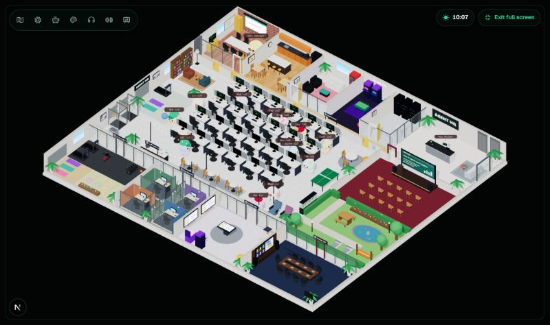
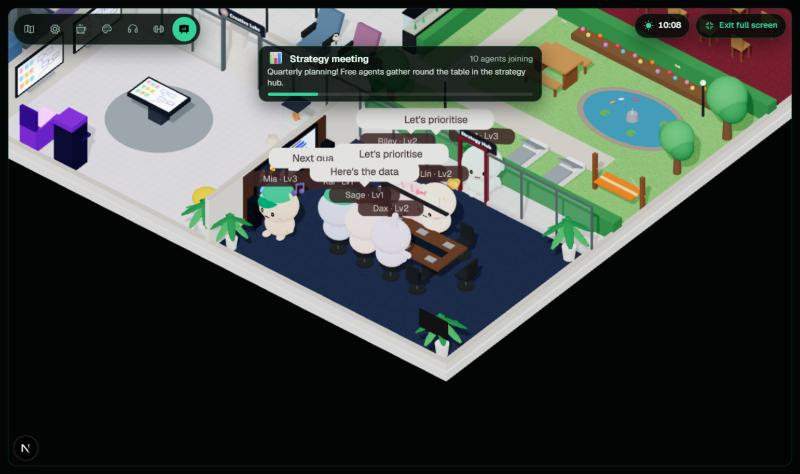
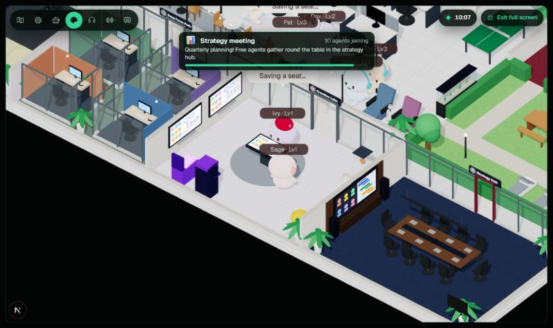
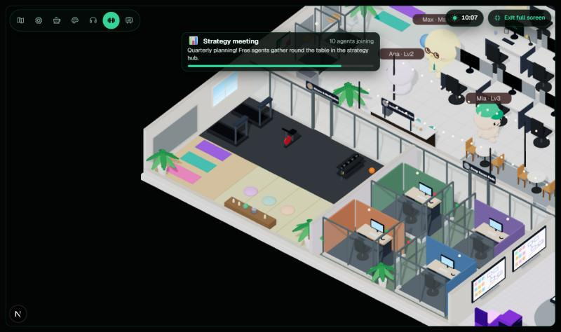
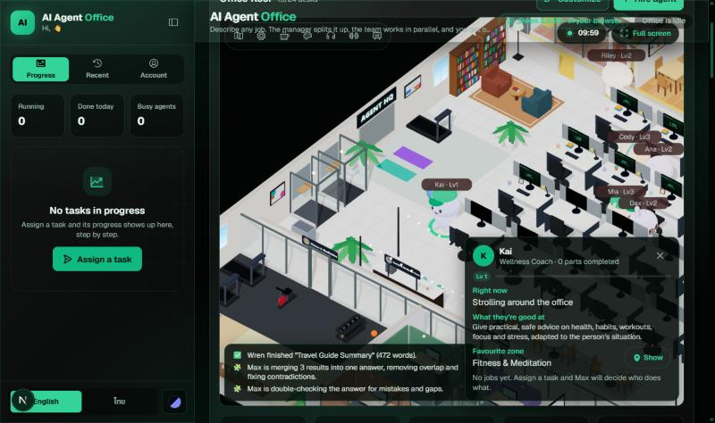
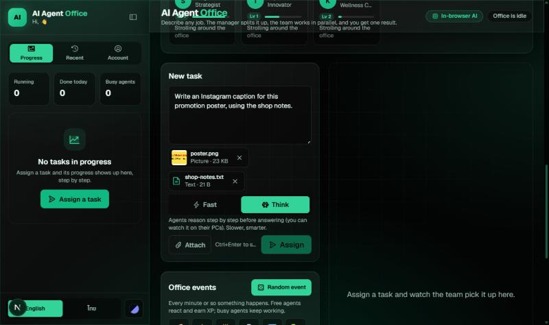

<div align="center">



# 🏢 AI Agent Office

**Hand any job to a team of AI agents and watch them work it out in a cosy 3D office, running entirely in your browser.**

[](https://ai-agent-office-one.vercel.app)


[Highlights](#-highlights) · [Screenshots](#-screenshots) · [The office](#%EF%B8%8F-the-office) · [The team](#-the-team) · [How it works](#-how-it-works) · [Run locally](#-run-locally)

</div>

---

## ✨ Highlights

| | |
|---|---|
| 🔒 **Private and free** | Qwen 3.5 runs on your graphics card through WebGPU. No API key, no server, and nothing you type leaves your device. |
| 🧑‍💼 **A real team** | Max the manager splits each task, picks the right agent for each part and explains why, then merges the results and double-checks the answer. |
| 🧠 **Think mode** | Agents write reasoning notes before answering, streamed live onto their desk PCs. |
| 📎 **Files and pictures** | Attach text files and pictures (drop, paste or browse). A vision model describes each picture for the team. |
| 🏙️ **A living office** | 13 animal agents work, take breaks, play ping-pong in pairs, meditate and hold strategy meetings across six working zones. |
| 🎥 **Follow cam** | Click any agent, or Max, and the camera follows them around the office. |
| 🌏 **English and ไทย** | The whole app, the 3D speech bubbles and the AI answers switch language. |
| 🎨 **Make it yours** | 5 themes, floors, desks, decorations, your office name in neon, break rules and time of day. |

## 📸 Screenshots

<table>
  <tr>
    <td width="50%"><br /><sub><b>Strategy meeting</b>: free agents gather in the hub to plan the quarter.</sub></td>
    <td width="50%"><br /><sub><b>Creative Labs</b>: whiteboards, a touch table, pinball and arcade.</sub></td>
  </tr>
  <tr>
    <td width="50%"><br /><sub><b>Fitness & Meditation</b> and <b>Deep Focus Pods</b>.</sub></td>
    <td width="50%"><br /><sub><b>Follow cam</b>: click an agent to follow them and see what they're up to.</sub></td>
  </tr>
  <tr>
    <td colspan="2" align="center"><br /><sub><b>New task</b>: attach pictures and files, and choose Fast or Think.</sub></td>
  </tr>
</table>

## 🗺️ The office

Six working zones, each with a name board. The toolbar on the 3D view flies the camera to any of them.

| | Zone | What's there |
|---|---|---|
| ⚙️ | **Engine Room** | The open-plan hall of 24 hot-desks. Every PC shows its agent's live output like a terminal. |
| ☕ | **Social & Wellness Core** | Open kitchen, café espresso bar and snacks, bistro tables, the wellness corner and nap chairs. |
| 🎨 | **Creative Labs** | Two digital whiteboards, a touch-screen table, a 3D printer, pinball, an arcade cabinet and a beanbag for big thoughts. |
| 🎧 | **Deep Focus Pods** | Four sound-proofed glass booths with felt walls, a desk each and red/green busy lights. |
| 🧘 | **Fitness & Meditation** | Treadmills, an exercise bike and dumbbells on a rubber floor; yoga mats with a mirror wall; a tatami corner with cushions and candles. |
| 📊 | **Strategy Hub** | A formal conference room: table for ten, walnut wall, video-call screen, speakers and a pendant light. |

Beyond the zones there's a meeting room with a live projector, a lounge, a game room, a server room, a reception **lobby** with Robo the robot, a **town hall** and a **garden** with a koi pond, picnic table, loungers and a hammock.

### Life in the office

- **Breaks follow the clock**: coffee in the morning, a lunch rush at noon, games after five. Each agent spends most breaks in their favourite zone.
- **Two-person activities need two people.** Ping-pong, foosball, the touch-table brainstorm and café chats start with an invitation: the agent asks the nearest free colleague, both hurry over and play the same game. If nobody's free they pick something else, and if a partner gets called away the other wraps up.
- **Max makes his rounds.** Between tasks he checks on the desks, reviews the roadmap in the hub, rehearses on the town-hall stage, visits the labs, grabs a coffee and says hi to Robo. He hurries back to the projector when work arrives.
- **19 office events**, timed to the hour: strategy meeting, hackathon, all-hands, garden picnic, pizza party, fire drill, birthday, yoga class, karaoke, movie night, ice cream, parcel delivery, power cut and more. There's also a welcome party for each new hire.
- Routes follow hand-placed waypoints through aisles and doorways. An automated check walks 29,000+ routes and a 3-hour simulation with zero collisions.

## 🤖 The team

| Agent | Role | Favourite zone |
|---|---|---|
| 🐥 **Max** | Manager: plans, assigns, merges, reviews | Everywhere (he makes the rounds) |
| Riley | Researcher | 🎧 Focus Pods |
| Wren | Writer | 🎧 Focus Pods |
| Ana | Analyst | 📊 Strategy Hub |
| Pat | Planner | 📊 Strategy Hub |
| Sage | Strategist | 📊 Strategy Hub |
| Dee | Designer | 🎨 Creative Labs |
| Ivy | Innovator | 🎨 Creative Labs |
| Cody | Engineer | ⚙️ Engine Room |
| Dax | Data Scientist | ⚙️ Engine Room |
| Mia | Marketer | ☕ Social & Wellness Core |
| Lin | Translator | ☕ Social & Wellness Core |
| Quinn | QA Tester | 🧘 Fitness & Meditation |
| Kai | Wellness Coach | 🧘 Fitness & Meditation |

Hire your own (name, role, instructions and favourite zone), up to one per desk (24).

## 🧠 How it works


| Step | What happens |
|---|---|
| 👁️ **Look** | Attached pictures are described by Phi 3.5 Vision. Text files are read as-is. |
| 📋 **Plan** | Max splits the task into 1-4 parts for the best-suited agents (structured JSON, with a reason for each). |
| ⌨️ **Work** | Each agent writes its part knowing the team's plan, streamed live to its desk PC. In **Think** mode it writes reasoning notes first. |
| 🧩 **Merge** | Max combines the parts into one answer, removing overlap and fixing contradictions. |
| 🔍 **Review** | Optional: Max double-checks the answer for mistakes and gaps. |

Every step lands on the task's timeline with a plain-language reason. Click any agent to see what they're doing right now and their latest output.

### Models

Everything runs on the GPU in your browser via [WebLLM](https://github.com/mlc-ai/web-llm). Models download once and are then cached.

| Choice | Model | Download | Graphics memory |
|---|---|---|---|
| **Automatic** (default) | Smart on computers, Light on phones; steps down if the device can't load it | | |
| Light | Qwen 3.5 2B | 1.3 GB | ~2.5 GB |
| Smart | Qwen 3.5 4B | 2.6 GB | ~4 GB |
| Max | Qwen 3.5 9B | 5.5 GB | ~6.5 GB |
| Pictures only | Phi 3.5 Vision | 2.4 GB | ~4 GB |

Pick one in **Account → AI model**. Bigger models write better answers but need a stronger GPU.

## 🎛️ Make it yours

- **Customize** (on the office floor): floor style, desk finish, accent colour, neon office sign, plants, rugs, art, lamps, desk items, aquarium and string lights.
- **Activities**: which breaks agents take, how often, and whether random events happen.
- **Time of day**: real clock, a 24-minute time-lapse, or fixed day, sunset or night lighting.
- **5 themes** (Matrix, Midnight, Sunset, Ocean, Daylight), each checked for WCAG AA contrast.
- **Motion**: full, follow device, or reduced. The 3D view lowers its resolution on slow devices to stay smooth.
- **Full screen** with the button or the **F** key.

## 🚀 Run locally

```bash
git clone https://github.com/salmonA001/ai-agent-office.git
cd ai-agent-office
npm install
npm run dev
```

Open http://localhost:3000. No keys or environment variables are needed. You need a browser with **WebGPU**: recent Chrome or Edge on a computer, or Safari 26+.

```bash
npm run build   # production build (fully static)
npm run lint
```

The app is fully static, so any static host works. The live demo deploys to Vercel on every push to `main`.

## 🧱 Tech stack

| Layer | Tools |
|---|---|
| App | Next.js 16 (App Router, Cache Components), React 19, TypeScript |
| 3D | React Three Fiber, drei, three.js: toon-shaded characters, canvas textures, orthographic isometric camera |
| AI | WebLLM on WebGPU: Qwen 3.5 (2B / 4B / 9B) and Phi 3.5 Vision |
| UI | Tailwind CSS 4, glassmorphism, Phosphor icons, react-markdown |

<details>
<summary><b>📁 Project structure</b></summary>

```text
src/
├─ app/                    # Next.js app shell, global styles and themes
├─ components/
│  ├─ Office.tsx           # page: office floor, task list, task view
│  ├─ TaskComposer.tsx     # new task: text, attachments, Fast / Think
│  ├─ OfficeScene.tsx      # 3D scene: agents, Max, camera, lights
│  ├─ OfficeFloor.tsx      # rooms, zones, furniture, signs
│  ├─ office-nav.ts        # waypoint graph, break spots, agent & manager walkers
│  ├─ office-events.ts     # random office events, XP and levels
│  ├─ camera-focus.ts      # zone flights and the follow cam
│  └─ Sidebar.tsx, OfficeCustomize.tsx, OfficeExplain.tsx, OfficeGame.tsx
└─ lib/
   ├─ browser-ai.ts        # WebLLM engine, model tiers, think mode, vision
   ├─ run-task.ts          # plan → work → merge → review
   ├─ agents.ts            # the team
   └─ i18n.tsx             # English / Thai
```

</details>

---

<div align="center">
<sub>Built with ☕ and a lot of tiny animal coworkers.</sub>
</div>
